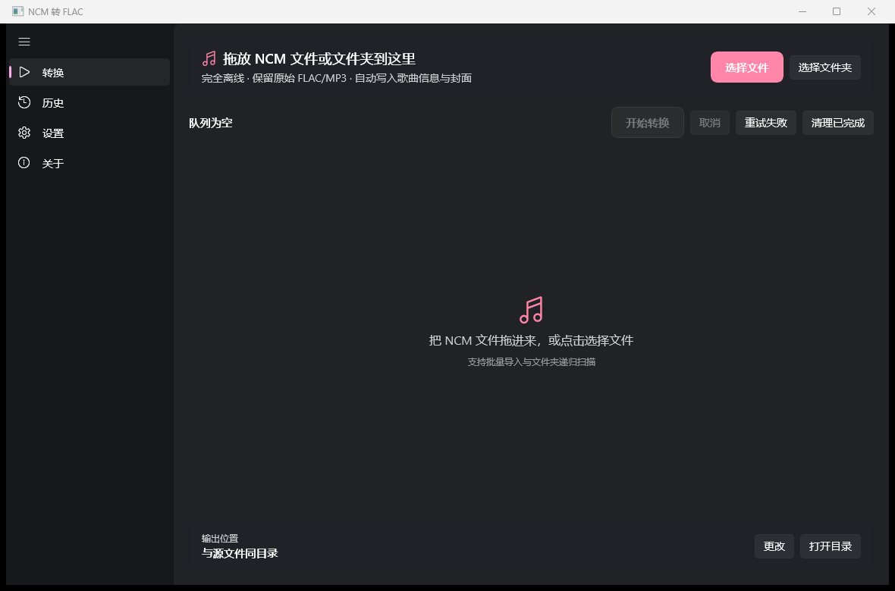
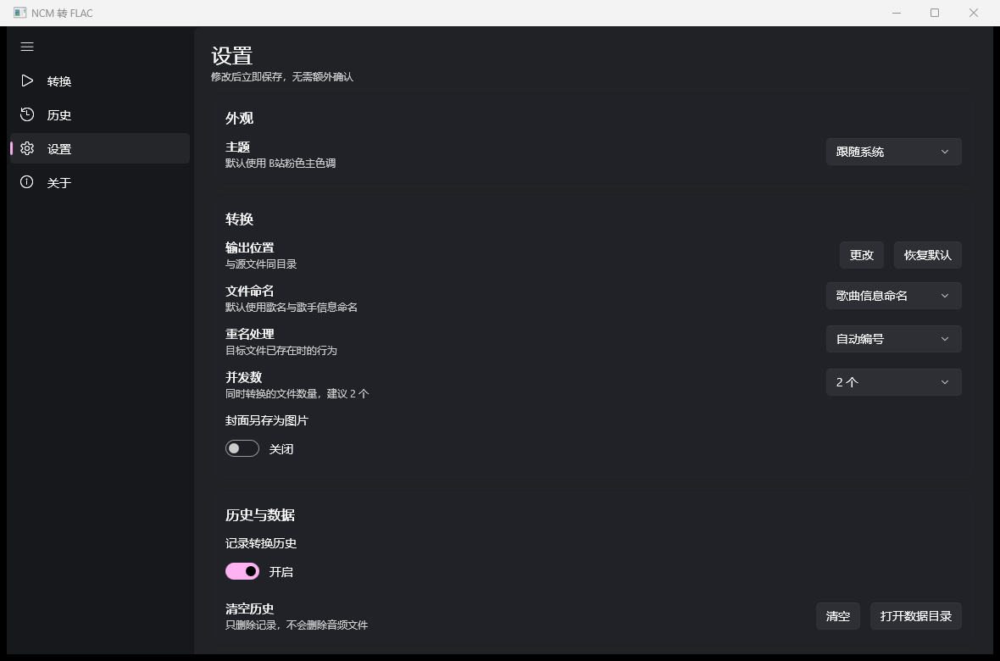
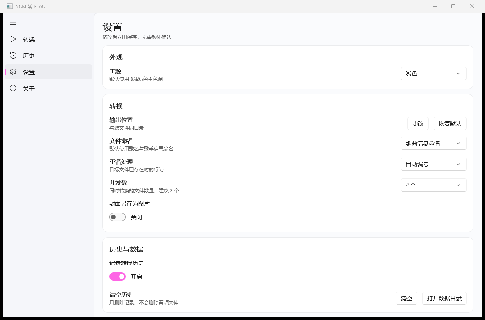
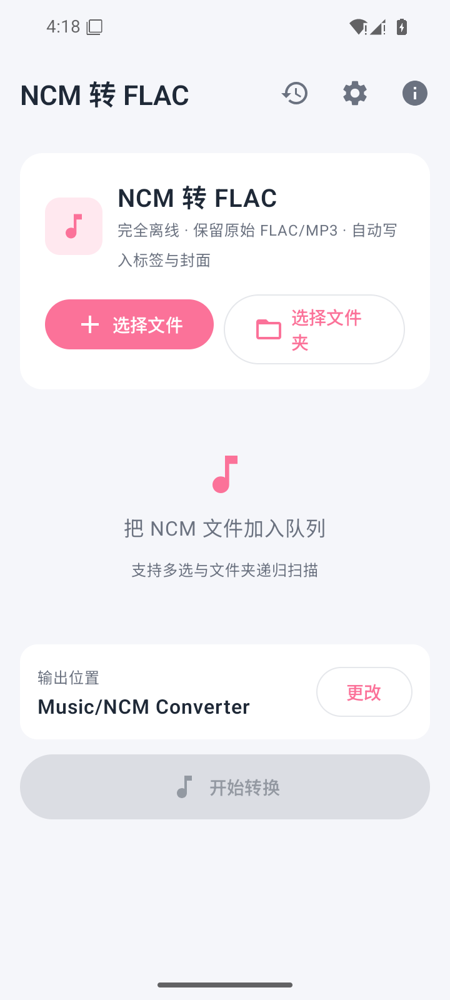
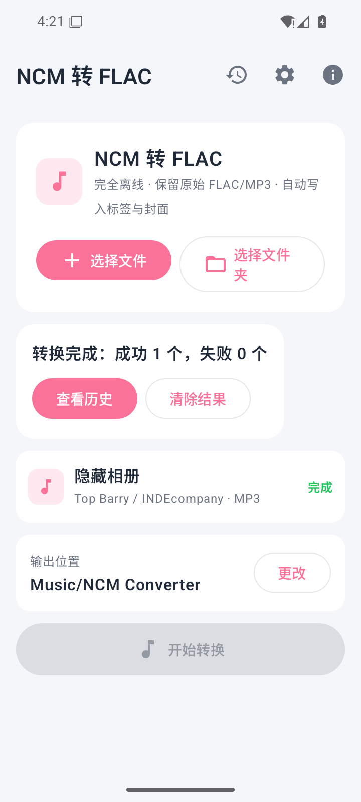
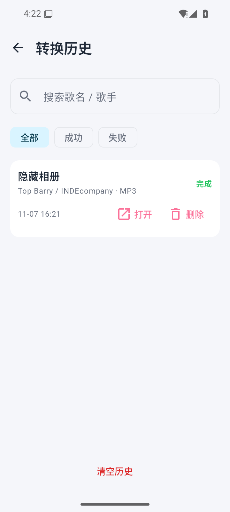
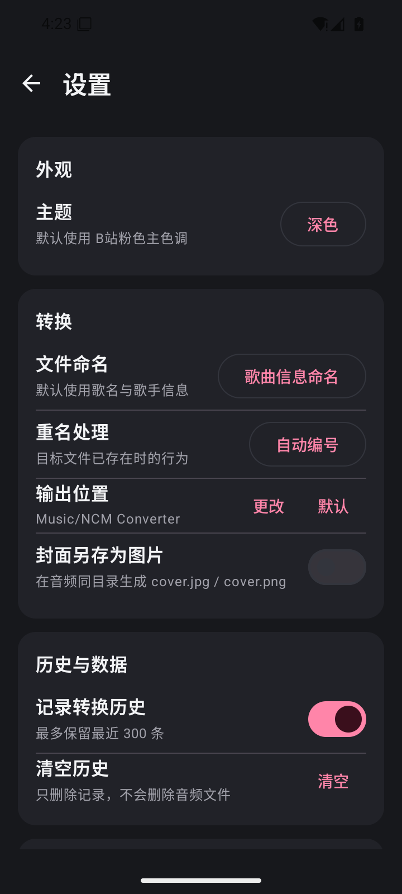

# NCM 转 FLAC（ncm-converter）

一款**完全离线**的 NCM 音频转换工具，提供 Windows 与 Android 客户端。

把网易云音乐客户端下载的 `.ncm` 文件还原为原始音频：FLAC 源输出 `.flac`，MP3 源输出 `.mp3`；只解密容器，不做二次编码，并保留歌曲名、歌手、专辑与内嵌封面。

> **项目状态：v0.1.0 已实现 Windows 与 Android 客户端，核心算法已用 4 个真实 NCM 样本验证。** 需求与技术方案见 [设计文档](docs/NCM转FLAC工具-设计文档.md)。

## 特性

- **无损还原**：只解密 NCM 容器，MP3 源不会被转成 FLAC，音质与体积不变
- **元数据与封面**：写入标题、歌手、专辑，嵌入容器内封面
- **批量处理**：文件/文件夹导入、队列、并发、进度、取消、失败重试
- **重名策略**：自动编号 / 跳过 / 覆盖
- **转换历史**：记录结果、耗时与输出位置，可筛选与清理
- **深浅主题**：跟随系统或手动切换
- **完全离线**：无网络请求、无账号、无遥测；Android 不申请 INTERNET 权限

## 平台与技术栈

| 平台 | 技术 |
| --- | --- |
| Windows 10 1809+ | C# / WinUI 3 / Windows App SDK / .NET |
| Android 8.0+ | Kotlin / Jetpack Compose / Material 3 / Coroutines |

两端各自实现同一套转换规则，并通过统一测试向量保证解密结果逐字节一致。

## 项目结构

```
.
├─ docs/                       # 设计文档与测试报告
├─ windows/
│  ├─ NcmConverter.sln
│  ├─ src/NcmConverter.Core/   # NCM 解析、解密、标签写入
│  ├─ src/NcmConverter.Cli/    # 命令行验证工具
│  ├─ src/NcmConverter.App/    # WinUI 3 客户端
│  └─ tests/                   # xUnit 单元测试
├─ android/
│  └─ app/
│     └─ src/main/java/com/ncmconverter/
│        ├─ core/              # Kotlin 解密与标签写入
│        ├─ data/              # 设置、历史、状态
│        ├─ service/           # 前台转换服务、输出写入
│        └─ ui/                # Compose 界面
└─ testdata/                   # 本地测试样本（版权文件，不提交）
```

## 构建

### Windows

需要 Windows 10 1809+、.NET 8 SDK、Windows App SDK。

```powershell
cd windows
dotnet build NcmConverter.sln -c Release
dotnet test NcmConverter.sln -c Release
dotnet run --project src/NcmConverter.Cli -- verify-all ..\testdata
dotnet run --project src/NcmConverter.App
```

Windows 有两种安装包，按需选择：

**EXE 安装包（推荐，可直接安装）**

- 产物：`dist/Windows/NcmConverter-0.1.0-setup.exe`（约 61 MB）
- 双击安装，无需管理员权限；默认安装到 `%LOCALAPPDATA%\Programs\NcmConverter`
- 自动创建开始菜单快捷方式，可在 Windows「设置 → 应用」中卸载
- 仅保留中文与英文语言资源；升级安装时会自动清理旧版本多余的区域语言文件夹
- 重新生成：`powershell -ExecutionPolicy Bypass -File windows\installer\build-installer.ps1`（需 Inno Setup 6）
- 安装包未使用受信任代码签名证书，SmartScreen 可能提示「未知发布者」；点击「更多信息 → 仍要运行」即可。要彻底消除提示，需要购买受信任的代码签名证书并对 EXE 签名。

**MSIX 安装包**

- 产物：`windows/artifacts/msix/NcmConverter_0.1.0.0_x64.msix`
- 配套自签名证书：`windows/artifacts/msix/NcmConverter.cer`
- 安装前需将证书导入「受信任的根证书颁发机构」，否则 Windows 会阻止安装

> MSIX 不能直接转换成 EXE；EXE 安装包是用 Inno Setup 对同一份 Windows 应用重新打包，二者安装的是同一程序。

### Android

需要 JDK 17、Android SDK 36、Gradle 8.13。仓库自带 Gradle Wrapper。

```bash
cd android
./gradlew assembleDebug
# 或
./gradlew assembleRelease
./gradlew testDebugUnitTest
```

APK 输出在 `android/app/build/outputs/apk/`。当前 release 包使用 Android Debug 证书签名，正式分发前请替换为自己的 keystore。

> 仓库路径包含中文时，`android/gradle.properties` 已设置 `android.overridePathCheck=true`；如果本机 Gradle 仍报路径问题，可将项目复制到纯 ASCII 路径构建。

### 测试基准

4 个真实样本的解密负载在 Windows 与 Android 两端必须逐字节一致，基准 SHA-256 见 [测试报告](docs/测试报告-2026-11-07.md)。

## 界面截图

### Windows







### Android









## 文档

- [需求与技术设计文档](docs/NCM转FLAC工具-设计文档.md)
- [测试报告（2026-11-07）](docs/测试报告-2026-11-07.md)

## 合规声明

本工具仅用于用户对自己**合法获得**的个人音频进行本地格式还原与备份。

- 本项目不提供音乐下载、抓取或破解会员内容的能力
- 不内置、不分发任何版权音频样本
- 与网易云音乐及其关联公司无任何关系，未获其授权或背书
- 请勿将转换后的音频用于传播、分发或任何侵犯版权的行为

因使用本工具产生的任何法律责任由使用者自行承担。

## 许可证

[MIT](LICENSE)
