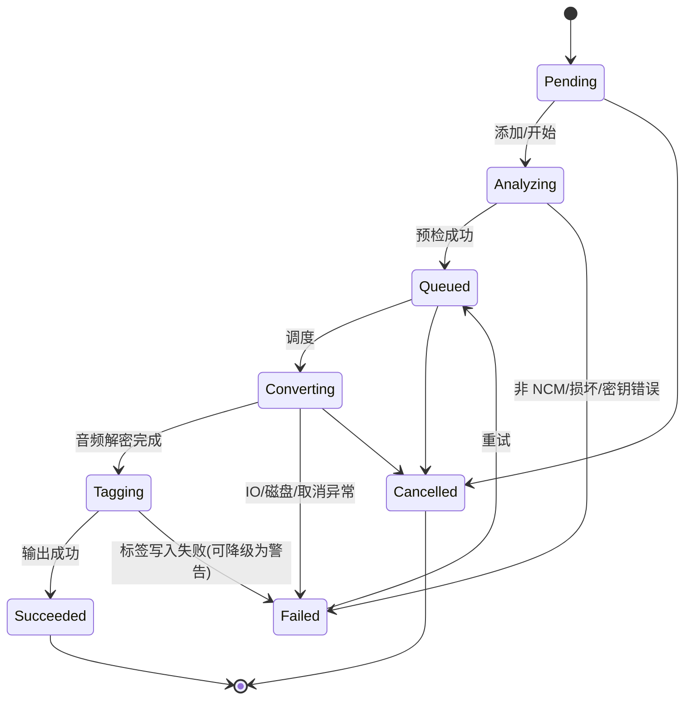
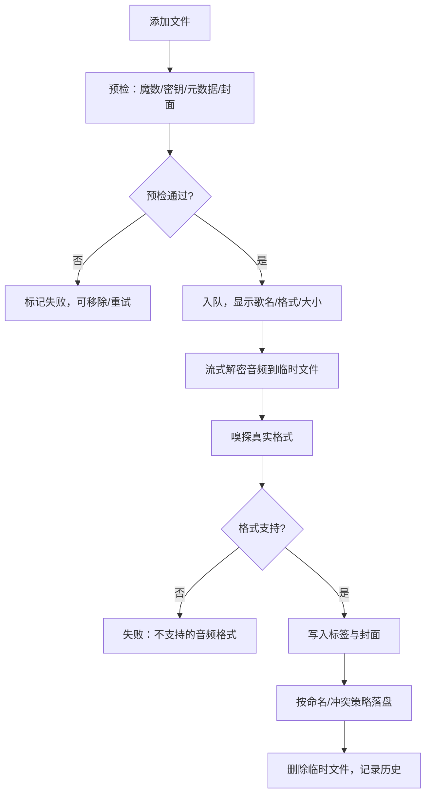
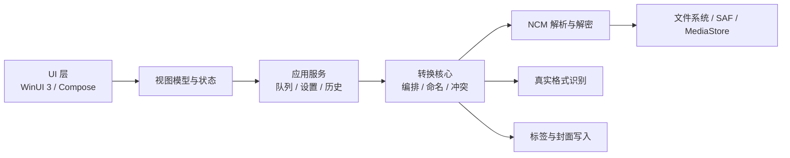

# NCM 转 FLAC 工具 · 需求与技术设计文档

> 版本：v0.1（待评审）  
> 日期：2026-11-07  
> 目标平台：Windows 10/11（C# / WinUI 3）、Android 8.0+（Kotlin / Jetpack Compose）  
> 文档状态：**评审中，未冻结**

---

## 1. 项目概述

### 1.1 背景

网易云音乐客户端下载的缓存/下载文件为 `.ncm` 专有容器，内部封装了加密后的原始音频（FLAC 或 MP3）以及歌曲元数据和封面。用户需要在本地把这些文件还原为标准音频，便于在任意播放器中使用。

### 1.2 产品目标

做一个**完全离线、零网络请求**的桌面 + 移动端工具：

- 将 `.ncm` 解密还原为原始音频：
  - 原始为 FLAC → 输出 `.flac`
  - 原始为 MP3 → 输出 `.mp3`（不做二次编码，不改变音质）
- 自动写入歌曲名、歌手、专辑，嵌入内嵌封面
- 提供完整的桌面/移动 UI：批量导入、队列、进度、取消、历史、设置、深浅主题
- 同一套转换规则在 Windows 与 Android 两端保持一致（字节级一致的解密结果）

### 1.3 非目标（本期不做）

| 项目 | 说明 |
|---|---|
| 其他平台加密格式 | QMC / MFLAC / KGM / KWM 等本期不支持，架构预留扩展点 |
| 音频转码 | 不做 MP3 → FLAC 等有损转无损的二次编码 |
| 在线能力 | 不联网、不下载封面、不登录账号、不上传文件、不收集遥测 |
| 音乐下载 | 不提供任何下载、抓取、破解会员内容的能力 |
| 批量重命名/音频编辑 | 不做裁剪、合并、音量调整等后期处理 |
| 多语言 | v1 仅简体中文，但字符串资源化，为英文预留 |

### 1.4 合规边界

本工具仅用于用户对自己**合法获得**的个人音频文件进行本地格式还原与备份。产品内需常驻以下声明（关于页 + 首次启动提示）：

> 本工具仅用于个人已合法获取音频的本地格式转换与备份，请勿用于传播、分发或任何侵犯版权的行为。因使用本工具产生的任何法律责任由使用者自行承担。

---

## 2. 已确认的产品决策

| 决策项 | 结论 | 影响 |
|---|---|---|
| 第一阶段格式范围 | **仅 NCM**，架构预留扩展位 | 解密核心聚焦 NCM，降低复杂度 |
| NCM 内含 MP3 时 | **保留原始格式**，输出 `.mp3` | 无损、快速、体积不膨胀 |
| Windows UI 框架 | **WinUI 3**（Windows App SDK） | Win11 原生观感，需注意打包与最低系统版本 |
| 附加功能 | 元数据+封面保留、深/浅主题、转换历史 | 均纳入本期范围 |
| 应用名称 | **NCM 转 FLAC** | 副标题说明"保留原始格式（FLAC/MP3）" |
| Windows 分发形式 | **MSIX 安装包** | 标准安装/卸载，需处理签名与证书信任 |
| Android 后台行为 | **允许后台继续**（前台服务 + 通知） | 切后台/锁屏不中断，通知栏可取消 |
| 测试样本 | **用户提供真实 NCM 样本**（T1–T7） | 封面与异常分支可最终验证 |
| 视觉主题 | **B站配色**：主色 `#FB7299`，辅助色 `#00A1D6` | 粉色主按钮，深浅主题分别适配 |

---

## 3. 用户与使用场景

### 3.1 目标用户

- 在网易云音乐客户端/手机端下载过歌曲，希望脱离客户端播放的用户
- 需要把旧设备里的 NCM 缓存整理归档到本地音乐库的用户
- 需要批量处理几十到几百个 NCM 文件的用户

### 3.2 核心场景

| 编号 | 场景 | 期望结果 |
|---|---|---|
| S1 | Windows 拖入单个 NCM | 立即转换，输出到源目录，写入标签与封面 |
| S2 | Windows 拖入整个文件夹 | 递归扫描 `.ncm`，批量排队转换 |
| S3 | Android 从文件管理器多选 NCM | 批量排队，转换到 `Music/NCM Converter/` |
| S4 | 转换中途取消 | 当前任务停止，临时文件清理，队列中未开始任务取消 |
| S5 | 某个文件损坏 | 该文件标记失败并显示原因，不影响其他文件 |
| S6 | 重名输出 | 按设置自动编号 / 跳过 / 覆盖 |
| S7 | 查看历史 | 能看到之前的转换记录、输出位置、失败原因 |
| S8 | 切换深色模式 | 立即生效，重启后保持 |

---

## 4. 功能需求

优先级：**P0 = 本期必须**，**P1 = 本期应做**，**P2 = 可延后**。

### 4.1 导入与预检

| ID | 优先级 | 需求 | 验收要点 |
|---|---|---|---|
| FR-01 | P0 | Windows 支持「选择文件」「选择文件夹」「拖拽文件/文件夹」 | 拖入文件夹递归扫描，仅收集 `.ncm`；拖入非 NCM 给出提示 |
| FR-02 | P0 | Android 支持 SAF 多选文件、选择目录、从其他应用"打开/分享"导入 | 多选返回的 URI 全部入队；权限持久化 |
| FR-03 | P0 | 添加后立即做轻量预检：校验魔数、解密密钥与元数据、读取封面 | 列表显示歌曲名/歌手/真实格式/文件大小；失败项直接标记 |
| FR-04 | P0 | 重复文件去重（同一路径/URI 已在队列中则忽略） | 不重复入队，给出轻提示 |

### 4.2 转换核心

| ID | 优先级 | 需求 | 验收要点 |
|---|---|---|---|
| FR-05 | P0 | 解析 NCM 容器并解密音频流，输出原始编码格式 | 输出音频与原始负载字节一致（标签写入前 SHA-256 相同） |
| FR-06 | P0 | 真实格式识别：FLAC / MP3 / M4A / AAC / OGG / WAV / 未知 | 扩展名与真实格式一致；未知格式报明确错误 |
| FR-07 | P0 | 写入元数据：标题、歌手（多人合并）、专辑 | 播放器/ffprobe 可读出；与 NCM 元数据一致 |
| FR-08 | P0 | 若容器存在内嵌封面，则嵌入输出音频；无封面不视为失败 | 有封面样本可读出 APIC/PICTURE；无封面正常完成 |
| FR-09 | P0 | 可选将封面另存为 `cover.jpg/png`（默认关闭） | 开启后与音频同目录生成封面文件 |
| FR-10 | P0 | 输出命名：默认「歌名 - 歌手」，可切换「保留原文件名」 | 非法字符清理、超长截断、空标题回退原文件名 |
| FR-11 | P0 | 重名策略：自动编号（默认）/ 跳过 / 覆盖 | 三种策略均不产生脏数据；覆盖需二次确认 |
| FR-12 | P0 | 输出位置选择；Windows 支持打开输出目录，Android 支持打开/分享输出 | 路径可记忆；权限失效时引导重新选择 |
| FR-13 | P0 | 流式转换，进度按字节推进；支持单任务取消与全部取消 | 取消后 1 秒内停止，临时文件删除 |
| FR-14 | P0 | 失败任务可单独重试 | 重试复用原配置，不重复入队 |
| FR-15 | P0 | 失败原因可读：区分非 NCM、截断、密钥错误、格式不支持、权限、磁盘满、IO 错误 | 每个错误有中文提示 + 可复制的技术详情 |

### 4.3 队列与批量

| ID | 优先级 | 需求 | 验收要点 |
|---|---|---|---|
| FR-16 | P0 | 队列展示：封面缩略图、标题、歌手、格式徽标、大小、状态、进度 | 100 条列表滚动流畅（虚拟化） |
| FR-17 | P0 | 队列操作：全选、移除、清空已完成、清空全部、开始/暂停/取消 | 状态机流转正确，无并发冲突 |
| FR-18 | P0 | 并发数可配置：Windows 1–4（默认 2），Android 1–2（默认 1） | 并发下进度不串行、不串文件 |
| FR-19 | P0 | 全部完成显示汇总：成功数 / 失败数 / 跳过数 / 总耗时 | 有 InfoBar 汇总，可跳转失败项 |
| FR-20 | P1 | Windows 支持 Ctrl+O 选择文件、Delete 移除、Ctrl+Enter 开始 | 快捷键可用 |

### 4.4 历史

| ID | 优先级 | 需求 | 验收要点 |
|---|---|---|---|
| FR-21 | P1 | 记录每次转换：歌曲信息、源格式、输出格式、大小、耗时、时间、状态、输出位置、错误 | 重启后仍存在；最多保留最近 300 条 |
| FR-22 | P1 | 历史筛选：全部 / 成功 / 失败；按日期分组；支持搜索标题/歌手 | 搜索即时生效 |
| FR-23 | P1 | 历史操作：打开输出文件/目录、复制路径、删除单条、清空全部 | 删除/清空需确认；不删除实际音频文件 |
| FR-24 | P1 | 封面缩略图在历史中展示（有则显示） | 不因缩略图读取失败而崩溃 |

### 4.5 设置与主题

| ID | 优先级 | 需求 | 验收要点 |
|---|---|---|---|
| FR-25 | P0 | 主题：跟随系统 / 浅色 / 深色，立即生效并持久化 | 全部页面、对话框、空状态均适配 |
| FR-26 | P0 | 输出位置、命名规则、重名策略、封面另存、并发数可配置并持久化 | 重启后保持 |
| FR-27 | P0 | Windows 默认输出到源文件同目录；Android 默认 `Music/NCM Converter/`（可改为 SAF 目录） | 首次使用有明确默认值 |
| FR-28 | P1 | 转换完成提示：Windows InfoBar；Android 通知/应用内提示 | 可关闭通知（Android） |
| FR-29 | P2 | 设置项「转换成功后打开输出目录」（默认关） | 不自动弹窗打扰 |

### 4.6 关于与安全

| ID | 优先级 | 需求 | 验收要点 |
|---|---|---|---|
| FR-30 | P0 | 关于页：版本、构建号、合规声明、第三方许可证 | 可滚动阅读 |
| FR-31 | P0 | 全程不发起网络请求；Android 不申请 INTERNET 权限；Windows 无联网代码 | 抓包/权限清单可验证 |
| FR-32 | P0 | 崩溃/错误不丢失队列：未开始任务保留，已完成写入历史 | 重启后历史与设置完好 |

---

## 5. 非功能需求

| 类别 | 指标 |
|---|---|
| 性能 | 纯流式 XOR + 磁盘写入，无转码；SSD 上应达到磁盘顺序读写瓶颈附近；100 个文件批量不崩溃、不泄漏 |
| 内存 | 单任务额外内存 < 40 MB；Windows 4 并发 < 250 MB；Android 单任务 < 64 MB（含封面） |
| 启动 | Windows < 2 s；Android 冷启动 < 1.5 s（中端机） |
| UI | 进度刷新节流至 ≤ 10 次/秒；列表虚拟化；60 fps |
| 稳定性 | 任意单个文件失败不影响整个队列；取消/退出后无残留临时文件 |
| 兼容性 | Windows 10 1809+ / Windows 11（x64、ARM64 可选）；Android 8.0（API 26）– Android 16（API 36） |
| 无障碍 | 键盘全流程可操作、焦点可见、控件有可读名称；Windows 200% 缩放、Android 字体缩放不破版 |
| 国际化 | 全部 UI 文案资源化（`.resw` / `strings.xml`），v1 仅中文 |
| 隐私 | 无网络、无遥测、无账号、无广告 SDK |
| 包体 | Windows MSIX < 80 MB；Android APK < 15 MB（无 NDK） |

---

## 6. UI/UX 设计

### 6.1 信息架构

**Windows**

```
转换（首页）
├─ 导入区（拖拽 / 选择文件 / 选择文件夹）
├─ 队列工具栏（统计 / 开始 / 取消 / 清理）
├─ 文件列表
└─ 底部输出栏（输出位置 / 更改 / 打开）

历史
├─ 搜索 + 状态筛选
└─ 按日期分组的记录列表

设置
├─ 外观（主题）
├─ 转换（输出位置 / 命名 / 重名 / 封面 / 并发）
├─ 通知与完成行为
└─ 数据（清空历史）

关于
```

**Android**

```
首页（转换）
├─ 顶部栏（标题 / 历史 / 设置 / 关于）
├─ 导入卡片（选择文件 / 选择文件夹）
├─ 已选列表
├─ 输出位置
└─ 底部主按钮（开始转换）

转换进行中（全屏或底部抽屉）
├─ 总进度 + 成功/失败计数
├─ 文件列表（状态 + 单项进度）
└─ 取消

历史 / 设置 / 关于（同 Windows 语义）
```

### 6.2 视觉规范

| Token | 浅色 | 深色 |
|---|---|---|
| 背景 | `#F5F6FA` | `#17181C` |
| 卡片/表面 | `#FFFFFF` | `#212228` |
| 边框/分隔 | `#E5E7EB` | `#33353D` |
| 主文本 | `#1F2937` | `#F3F4F6` |
| 次文本 | `#6B7280` | `#A1A1AA` |
| 主色 Accent（B站粉） | `#FB7299` | `#FF85A9` |
| 主色 Hover / Pressed | `#E45C86` / `#C94E74` | `#FF9EB8` / `#FFB3C8` |
| 辅助色（B站蓝） | `#00A1D6` | `#33B5E5` |
| 浅粉底 / 选中态 | `#FFE8EF` | `#3A2732` |
| 成功 | `#16A34A` | `#22C55E` |
| 警告 | `#D97706` | `#F59E0B` |
| 错误 | `#DC2626` | `#EF4444` |

- **品牌主色采用 B站粉 `#FB7299`**：主按钮粉色填充 + 白色文字（600 字重）；次按钮浅粉底/描边 + 粉字
- 进度条、开关开启态、列表选中态、焦点边框统一使用主色；信息链接与次要强调使用 B站蓝 `#00A1D6`
- 成功 / 警告 / 错误保持语义色，不与品牌粉混用；深色模式下粉色提亮为 `#FF85A9`，保证暗底可读
- 圆角：卡片 12 px，按钮/输入 8 px，徽标 6 px
- 间距：4 / 8 / 12 / 16 / 24
- 字体：Windows 使用 Segoe UI Variable + 微软雅黑回退；Android 使用系统默认
- 标题 20/24，正文 14/16，辅助 12
- 状态徽标：`FLAC`（B站蓝）、`MP3`（橙）、`失败`（红）、`完成`（绿）、`跳过`（灰）
- 图标风格：线性、2 px 描边；应用图标为「音符 + 解锁箭头」概念，需提供 16–256 px 多尺寸（Windows）与自适应图标（Android）

### 6.3 Windows 界面（WinUI 3）

窗口默认 1200×780，最小 1000×680；`Mica` 背景；左侧 `NavigationView`（展开 220 px，紧凑 48 px）。

**转换页线框**

```
┌─────────────────────────────────────────────────────────────┐
│  NCM 转 FLAC                                        ─  □  × │
├────────────┬────────────────────────────────────────────────┤
│  转换   ●  │  ┌──────────────────────────────────────────┐  │
│  历史      │  │     拖放 .ncm 文件或文件夹到这里           │  │
│  设置      │  │     [ 选择文件 ]   [ 选择文件夹 ]          │  │
│  关于      │  └──────────────────────────────────────────┘  │
│            │                                                │
│            │  队列 3 个 · 完成 1 · 失败 0   [开始] [取消]     │
│            │  ┌──────────────────────────────────────────┐  │
│            │  │ ▣ 封面  歌名 / 歌手        FLAC 120MB 78% │  │
│            │  │         [████████████░░░░░]      [移除]   │  │
│            │  └──────────────────────────────────────────┘  │
│            │                                                │
│            │  输出：D:\Music\NCM 输出      [更改] [打开目录]  │
└────────────┴────────────────────────────────────────────────┘
```

**交互细节**

| 区域 | 行为 |
|---|---|
| 拖拽区 | 拖入高亮；支持多文件与文件夹；非 NCM 只提示不阻塞 |
| 列表项 | 悬停显示移除按钮；点击展开详情（路径、时长、码率、封面预览） |
| 开始 | 无任务时禁用；转换中变为「暂停」与「取消」 |
| 失败项 | 红色状态 + 「重试」按钮 + 「详情」链接 |
| 空状态 | 插画 + 文案「把 NCM 文件拖进来，或点击选择文件」+ 快捷按钮 |
| 完成汇总 | `InfoBar` 成功样式：「已转换 12 个，失败 2 个」+「查看失败项」 |
| 输出栏 | 未指定时显示「与源文件同目录」；路径过长中间省略，悬停显示全路径 |

**历史页**：顶部搜索框 + 状态下拉；`ListView` 按日期分组；条目右侧「打开」「目录」「删除」；空状态「还没有转换记录」。

**设置页**：卡片式分组，每行左侧标题+说明、右侧控件；修改即保存（无「保存」按钮）；「清空历史」为危险操作，需确认对话框。

**关于页**：应用图标、名称、版本、构建时间、合规声明、「查看第三方许可证」展开区。

### 6.4 Android 界面（Compose / Material 3）

单 Activity；`Scaffold` + 顶部 `TopAppBar`；边到边显示；主色 `#5B6CF9`；动态取色关闭，保证品牌一致。

**首页线框**

```
┌───────────────────────────────────┐
│  NCM 转 FLAC              ⋮       │
│                                   │
│  ┌─────────────────────────────┐  │
│  │  ＋ 选择 NCM 文件            │  │
│  │  支持多选 · 本地离线转换      │  │
│  └─────────────────────────────┘  │
│                                   │
│  已选 3 个文件            [清空]   │
│  ┌─────────────────────────────┐  │
│  │ ♪ 歌名 / 歌手   FLAC  ×     │  │
│  │ ♪ 歌名 / 歌手   MP3   ×     │  │
│  └─────────────────────────────┘  │
│                                   │
│  输出位置  Music/NCM Converter ›  │
│                                   │
│  [        开始转换（3）        ]   │
└───────────────────────────────────┘
```

**转换中**：整体进度卡片（百分比 + 成功/失败数）、可滚动的单项列表、底部「取消」；支持切后台，通知栏显示进度与取消动作。

**历史页**：日期分组列表；条目显示封面缩略图、标题、结果、时间；点击进入详情底部弹窗（路径、格式、大小、耗时、错误详情、打开/分享、删除）。

**设置页**：分组列表（外观 / 转换 / 通知 / 数据 / 关于）；主题三选一；输出位置显示当前目录并可更改；重名策略下拉；清空历史需确认。

**系统适配**

- Android 13+ 首次转换前请求通知权限（拒绝不影响转换）
- Android 8–9 使用 MediaStore 输出时请求存储权限；10+ 无需存储权限
- 支持系统字体缩放、深色模式、横竖屏
- 返回手势：转换中返回弹出「后台继续 / 取消转换」选择

### 6.5 任务状态机



> 标签写入失败时默认**降级为警告**：音频仍输出，记录「元数据未写入」，状态仍为成功。

### 6.6 核心流程



### 6.7 空状态与错误提示

| 场景 | 展示 |
|---|---|
| 队列为空 | 插画 + 引导按钮 |
| 拖入非 NCM | `InfoBar` 警告：「已忽略 3 个非 NCM 文件」 |
| 文件损坏 | 条目红字「文件不完整或已损坏」+ 详情 |
| 密钥解析失败 | 「无法解析该 NCM 的密钥，可能来自不兼容的客户端版本」+ 详情 |
| 格式不支持 | 「内部音频格式 X 暂不支持」 |
| 权限失效 | 「无法写入所选目录，请重新选择输出位置」+ 按钮 |
| 磁盘空间不足 | 「目标磁盘空间不足」+ 剩余空间提示 |
| 部分失败汇总 | 「12 个成功，2 个失败」+「查看失败项」 |

---

## 7. 技术架构

### 7.1 总体分层

两端共享同一套**逻辑规范**，各自独立实现（不共享二进制），用统一测试向量保证行为一致。



### 7.2 Windows 技术栈

| 项目 | 选型 |
|---|---|
| 语言/运行时 | C# 12，.NET 10 LTS（如 WinUI 工具链要求，可回退 .NET 8 LTS） |
| UI | WinUI 3 + Windows App SDK 最新稳定版 |
| MVVM | CommunityToolkit.Mvvm（`ObservableObject` / `RelayCommand`） |
| 文件对话框 | Windows App SDK `FileOpenPicker` / `FolderPicker`（`InitializeWithWindow`） |
| 标签写入 | TagLib#（TagLibSharp） |
| 序列化 | `System.Text.Json` |
| 测试 | xUnit + 测试向量 |
| 打包 | 单项目 MSIX（默认）+ 可选自包含便携包 |

**项目结构**

```
windows/
├─ NcmConverter.sln
├─ src/
│  ├─ NcmConverter.Core/          # 纯逻辑，无 UI 依赖
│  │  ├─ Ncm/                     # 容器解析、密钥、元数据、音频解密
│  │  ├─ Audio/                   # 格式嗅探
│  │  ├─ Tagging/                 # TagLib# 适配
│  │  ├─ Conversion/              # 引擎、队列、命名、冲突
│  │  ├─ History/                 # 历史存储
│  │  └─ Settings/                # 设置存储
│  └─ NcmConverter.App/           # WinUI 3
│     ├─ Views/                   # Convert/History/Settings/About
│     ├─ ViewModels/
│     ├─ Services/                # Picker/DragDrop/Theme/Notification
│     └─ Assets/
└─ tests/NcmConverter.Core.Tests/
```

### 7.3 Android 技术栈

| 项目 | 选型 |
|---|---|
| 语言 | Kotlin 2.x |
| UI | Jetpack Compose + Material 3 |
| 异步 | Coroutines + Flow + StateFlow |
| 存储 | DataStore（设置）、Room（历史） |
| 文件访问 | SAF（`OpenMultipleDocuments` / `OpenDocumentTree`）、MediaStore（输出） |
| 后台 | 前台服务（`dataSync` 类型）+ 通知进度 |
| 标签写入 | **自研** ID3v2.3 / FLAC VorbisComment + PICTURE 写入器（避免第三方库在 Android 上的兼容风险） |
| 图片 | Coil（封面缩略图） |
| 测试 | JUnit + 测试向量 |
| 构建 | AGP 8.x、Gradle 8.x、JDK 17、compileSdk 36、minSdk 26、targetSdk 36 |

**项目结构**

```
android/
├─ settings.gradle.kts
├─ build.gradle.kts
└─ app/src/main/java/.../ncmconverter/
   ├─ core/ncm/          # 解析、密钥、元数据、音频解密
   ├─ core/audio/        # 格式嗅探
   ├─ core/tagging/      # ID3v2.3 / FLAC 标签写入
   ├─ domain/            # 转换引擎、队列、命名策略
   ├─ data/              # DataStore、Room、SAF/MediaStore 网关
   ├─ service/           # 前台转换服务 + 通知
   └─ ui/                # Compose 页面、主题、组件
```

### 7.4 核心模块职责

| 模块 | 职责 | 平台差异 |
|---|---|---|
| NCM 解析器 | 校验魔数、读取各段长度、解密密钥/元数据、提取封面、定位音频起点 | 仅 IO 抽象不同 |
| 音频解密器 | 构建 keybox，按块 XOR 解密，维护全局字节偏移 | 相同算法 |
| 格式嗅探 | 根据解密后首字节判定真实容器，给出扩展名与 MIME | 相同规则 |
| 标签写入 | FLAC VorbisComment + PICTURE；MP3 ID3v2.3 + APIC | Windows 用 TagLib#；Android 自研 |
| 转换引擎 | 预检 → 解密 → 嗅探 → 标签 → 落盘 → 历史；错误映射 | SAF vs 文件路径 |
| 队列 | 并发调度、取消、重试、汇总统计 | 相同语义 |
| 命名策略 | 默认信息命名/原文件名；非法字符清理；冲突策略 | 非法字符集不同 |

### 7.5 并发模型

**Windows**

- `ConversionQueue` 内部使用 `Channel<ConversionTask>` + N 个消费 worker（N = 设置并发数）
- 每个任务独立 `CancellationTokenSource`；「全部取消」遍历取消
- 进度通过 `IProgress<ConversionProgress>` 回传，UI 侧 100 ms 节流
- 文件写入先写 `.tmp`，完成后原子移动到目标名；失败/取消时删除 `.tmp`

**Android**

- 前台服务内 `CoroutineScope(SupervisorJob + Dispatchers.IO)`，信号量限制 1–2 个并发
- 状态通过 `StateFlow` 暴露给 UI；服务与 Activity 解耦
- 输出到 MediaStore 时使用 `IS_PENDING=1` 写入，完成后再置 0；SAF 目录同样先写临时文件再改名
- 服务停止/取消时清理临时文件

### 7.6 数据模型

```kotlin
// Android 侧示意；C# 侧为等价 record
data class TrackMetadata(
    val title: String?,          // musicName
    val artists: List<String>,   // artist[][1]
    val album: String?,          // album
    val bitrate: Int?,           // bitrate (bps)
    val durationMs: Long?,       // duration
    val declaredFormat: String?, // format（仅参考，最终以嗅探为准）
    val coverUrl: String?        // cover（仅记录，不联网下载）
)

enum class TaskState { Pending, Analyzing, Queued, Converting, Tagging, Succeeded, Failed, Cancelled, Skipped }

data class ConversionTask(
    val id: String,              // UUID
    val sourceRef: String,       // Windows 路径 / Android content URI
    val displayName: String,
    val sourceSize: Long,
    val metadata: TrackMetadata?,
    val state: TaskState,
    val progress: Float,         // 0..1
    val outputRef: String?,      // 输出路径/URI
    val errorCode: String?,
    val errorMessage: String?
)

data class HistoryEntry(
    val id: String,
    val title: String?,
    val artists: List<String>,
    val album: String?,
    val sourceFormat: String?,
    val outputFormat: String,
    val sourceSize: Long,
    val outputSize: Long?,
    val outputRef: String?,
    val finishedAtEpochMs: Long,
    val elapsedMs: Long,
    val status: String,          // success / failed
    val errorCode: String?,
    val errorMessage: String?,
    val coverThumbUri: String?   // 可选，缩略图缓存
)
```

### 7.7 关键接口

**C#**

```csharp
public interface INcmDecoder
{
    Task<NcmFileInfo> InspectAsync(string path, CancellationToken ct);
    Task<DecodeResult> DecodeAsync(
        string path, Stream output, DecodeOptions options,
        IProgress<DecodeProgress> progress, CancellationToken ct);
}
```

**Kotlin**

```kotlin
interface NcmDecoder {
    suspend fun inspect(uri: Uri): NcmFileInfo
    suspend fun decode(
        uri: Uri, sink: OutputSink, options: DecodeOptions,
        onProgress: (DecodeProgress) -> Unit
    ): DecodeResult
}
```

扩展位：`AudioContainerDecoder` 接口按「魔数匹配 + 解密器」注册，后续支持 QMC/KGM 时无需改动 UI 与队列。

---

## 8. NCM 解密实现方案（核心）

> 以下结构基于公开实现与社区文档整理，**最终以样本实测为准**。实现必须做字段合法性探测，不能盲信固定偏移。

### 8.1 容器结构

| 顺序 | 长度 | 字段 | 说明 |
|---|---|---|---|
| 1 | 8 B | magic | ASCII `CTENFDAM` |
| 2 | 2 B | version | 常见 `0x01 0x70`；仅记录，不强制校验 |
| 3 | 4 B | keyLen | uint32 LE |
| 4 | keyLen | keyBlob | `163 key(Don't modify):` + Base64 密文 |
| 5 | 4 B | metaLen | uint32 LE |
| 6 | metaLen | metaBlob | 同前缀 + Base64 密文 |
| 7 | 4 B | crc32 | 含义未公开；**仅记录，不做阻断校验** |
| 8 | 5 B | reserved | 保留字节，跳过 |
| 9 | 4 B | coverLen | uint32 LE；可能为 0 |
| 10 | coverLen | cover | 内嵌封面，通常 JPEG/PNG |
| 11 | 剩余 | audio | 加密音频流，直至文件末尾 |

健壮性处理：

- `coverLen` 必须满足 `> 0 && <= 20 MB && 不超过文件剩余长度`，否则视为无封面，并将音频起点回退到第 8 段之后
- 音频起点最终通过「解密前 4 KB 并嗅探格式」确认；若失败，尝试偏移校正（±1 字节级探测）并记录诊断日志
- 所有长度字段做上界校验，防止恶意文件导致超大内存分配

### 8.2 密钥解密

```
prefix = "163 key(Don't modify):"   // 22 字节
cipher = Base64Decode(keyBlob[22:]) // 去空白，长度必须为 16 的倍数
plain  = AES-128-ECB-Decrypt(cipher, key = ASCII("neteasecloudmusic"))
key    = plain[6:]                  // 去掉固定前缀 "music:"
```

- AES 使用 ECB、PKCS7 前需注意：该数据为固定块解密，无填充处理
- Base64 解码失败、长度非 16 倍数、AES 结果前缀不符 → 报 `E003_KEY_DECRYPT`
- 密钥为空 → `E003`

### 8.3 元数据解密

```
prefix = "163 key(Don't modify):"
cipher = Base64Decode(metaBlob[22:])
plain  = AES-128-ECB-Decrypt(cipher, "neteasecloudmusic")
json   = UTF8(plain[6:])            // 去掉 "music:"
```

元数据为 JSON（UTF-8），常见字段：

```json
{
  "musicId": "123456789",
  "musicName": "歌曲名",
  "artist": [[123456, "歌手 A"], [234567, "歌手 B"]],
  "album": "专辑名",
  "bitrate": 320000,
  "duration": 245000,
  "format": "mp3",
  "cover": "https://p1.music.126.net/xxx.jpg"
}
```

解析策略：

- 字段缺失/类型异常 → 对应字段置空，继续转换（`E004` 仅作为警告）
- `artist` 兼容 `[[id, name]]` 与 `["name"]` 两种形态
- `duration` 单位毫秒；`bitrate` 单位 bps
- `format` 仅作参考，输出扩展名以真实嗅探结果为准
- 整体 JSON 解析失败 → 无标签转换，记录警告，不阻断

### 8.4 音频流解密

NCM 使用基于密钥的 keybox（RC4 变体）对音频逐字节 XOR，keybox 只构建一次，字节位置参与索引。

```
// 构建 keybox
keybox[0..255] = 0..255
last = 0
k = 0
for i in 0..255:
    swap = keybox[i]
    last = (swap + last + key[k]) & 0xFF
    k = (k + 1) % keyLen
    keybox[i] = keybox[last]
    keybox[last] = swap

// 解密（n 为音频流全局字节下标，从 0 开始）
j = (n + 1) & 0xFF
t = (keybox[j] + j) & 0xFF
plain[n] = cipher[n] ^ keybox[(keybox[j] + keybox[t]) & 0xFF]
```

实现要求：

- **分块流式**：64 KB 缓冲区；跨块必须携带全局 `processedBytes`，不能按块内下标计算
- 输出先写临时文件（Windows `.tmp`，Android 缓存/待提交 MediaStore 项）
- 进度 = 已处理加密字节 / 音频总字节；音频总字节 = 文件大小 − 音频起点
- 取消在每个块边界检查，响应时间 < 100 ms
- 解密结果不做二次编码，字节原样写入

### 8.5 真实格式嗅探

| 首字节特征 | 判定 | 扩展名 | 标签支持 |
|---|---|---|---|
| `fLaC` | FLAC | `.flac` | 是 |
| `ID3` 或 `0xFF Ex/Fx` 帧同步 | MP3 | `.mp3` | 是 |
| offset 4 为 `ftyp` | M4A/MP4 | `.m4a` | 否（警告） |
| `OggS` | OGG | `.ogg` | 否（警告） |
| `RIFF` + `WAVE` | WAV | `.wav` | 否（警告） |
| 其他 | 未知 | — | 报 `E006_UNSUPPORTED_AUDIO` |

- 嗅探在解密输出前 4 KB 后即可完成，可尽早失败，避免写完整临时文件
- 若声明格式与真实格式冲突，以真实格式为准并在历史记录中保留声明值

### 8.6 封面处理

- 封面字节来自容器第 10 段，可能为空
- MIME 通过魔数判定：`FF D8 FF` → JPEG；`89 50 4E 47` → PNG；其他 → 以 `application/octet-stream` 保存/嵌入并警告
- 尺寸解析：JPEG 读 SOF 段，PNG 读 IHDR，用于 FLAC PICTURE 块字段与 UI 缩略图；解析失败时字段填 0
- 嵌入规则：
  - FLAC：PICTURE 块，类型 3（front cover），描述为空
  - MP3：ID3v2.3 APIC 帧，编码 UTF-16，图片类型 3
- 默认不单独导出封面；设置开启后在同目录生成 `cover.jpg` / `cover.png`（重名按冲突策略）

### 8.7 标签写入

**FLAC（两端语义一致）**

- 保留 `STREAMINFO` 与音频帧
- 移除已有 `VORBIS_COMMENT`、`PICTURE`，写入新块：
  - `TITLE` = 标题
  - `ARTIST` = 歌手（多个用 ` / ` 连接，与展示一致）
  - `ALBUM` = 专辑
- 无封面则不写 PICTURE
- 写入方式：重建元数据区 + 原音频帧，整体写临时文件后原子替换

**MP3（两端语义一致）**

- 移除文件头部已有 ID3v2 与尾部 ID3v1（避免与旧标签冲突）
- 写入 ID3v2.3：`TIT2`、`TPE1`、`TALB`、`APIC`（有封面时）
- 保留原始音频帧字节不变
- 无元数据时仍可输出，仅不写标签

**其他容器**：不写标签，输出原文件，历史记录警告「该格式不支持写入标签」。

### 8.8 输出命名与冲突

**默认命名（信息命名）**

```
{title} - {artist}.{ext}
```

- `title` 为空 → 使用源文件名（去扩展名）
- `artist` 为空 → 只输出 `{title}.{ext}`
- 多歌手用 ` / ` 连接

**原文件名模式**

```
{sourceStem}.{ext}
```

**清理规则**

- Windows 禁用字符：`< > : " / \ | ? *` 及控制字符；结尾的 `.` 和空格去除
- Android 禁用：`/`、`\0`；避免以 `.` 开头
- 统一压缩连续空格，最长 180 字符（为冲突后缀预留空间）
- 清理后为空 → 回退为 `未命名`
- 统一 NFC 归一化，避免重复文件

**冲突策略**

| 策略 | 行为 |
|---|---|
| 自动编号（默认） | `歌名 - 歌手 (1).flac`、`(2)`…，上限 999，仍冲突则报错 |
| 跳过 | 任务状态 `Skipped`，历史记录原因「目标已存在」 |
| 覆盖 | 先删除目标再写入；UI 二次确认（可记住本次选择） |

### 8.9 错误码

| 错误码 | 场景 | 用户提示 | 是否阻断 |
|---|---|---|---|
| E001_NOT_NCM | 魔数不匹配 | 不是有效的 NCM 文件 | 是 |
| E002_TRUNCATED | 读取越界/文件不完整 | 文件不完整或已损坏 | 是 |
| E003_KEY_DECRYPT | 密钥 Base64/AES 失败 | 无法解析该文件的密钥，可能不兼容 | 是 |
| E004_META_DECRYPT | 元数据解密/JSON 失败 | 已跳过歌曲信息（警告） | 否 |
| E005_COVER_INVALID | 封面长度/魔数异常 | 已跳过封面（警告） | 否 |
| E006_UNSUPPORTED_AUDIO | 真实格式不支持 | 内部音频格式暂不支持 | 是 |
| E007_PERMISSION | 输出无权限/URI 失效 | 无法写入输出位置，请重新选择 | 是 |
| E008_DISK_FULL | 空间不足 | 目标磁盘空间不足 | 是 |
| E009_TAG_WRITE | 标签写入失败 | 已输出音频，但未写入歌曲信息（警告） | 否 |
| E010_IO | 读写失败/文件被占用 | 读取或写入失败，请检查文件是否被占用 | 是 |
| E011_CONFLICT_SKIPPED | 重名跳过 | 目标文件已存在，已跳过 | 否 |
| E012_CANCELLED | 用户取消 | 已取消 | 否 |
| E013_UNKNOWN | 未分类异常 | 未知错误，请查看详情 | 是 |

错误对象统一包含：错误码、中文摘要、技术详情（异常类型/堆栈摘要/文件偏移），历史与详情面板可复制。

### 8.10 健壮性与安全

- 所有长度字段：`uint32` 读取后转 `long`，并做 `<= 文件大小`、`<= 硬上限` 双重校验
- 单文件解析读取上限：头部 + 元数据 + 封面不超过 32 MB
- 不信任 `format` 字段；不信任文件名；不解压任何外部内容
- 临时文件命名随机，权限遵循系统默认；失败/取消必定清理
- 不对源文件做任何写操作（不移动、不删除、不重命名）
- Windows 长时间任务不阻塞 UI 线程；Android 使用前台服务避免被系统回收

---

## 9. 数据存储

### 9.1 Windows

| 数据 | 位置 | 格式 |
|---|---|---|
| 设置 | `%LOCALAPPDATA%\NcmConverter\settings.json` | JSON，原子写入（先写临时文件再替换） |
| 历史 | `%LOCALAPPDATA%\NcmConverter\history.json` | JSON 数组，最多 300 条 |
| 日志 | `%LOCALAPPDATA%\NcmConverter\logs\app-YYYYMMDD.log` | 文本，默认保留 7 天 |
| 封面缩略图缓存 | `%LOCALAPPDATA%\NcmConverter\cache\covers\` | 可清理 |

> 不使用注册表；卸载 MSIX 时由系统清理。

### 9.2 Android

| 数据 | 位置 | 格式 |
|---|---|---|
| 设置 | DataStore Preferences | key-value |
| 历史 | Room 数据库 `ncm_converter.db` | `history` 表，最多 300 条 |
| 封面缩略图 | `cacheDir/covers/` | 文件缓存，可清理 |
| 输出 | MediaStore `Music/NCM Converter/` 或用户 SAF 目录 | 音频文件 |

### 9.3 历史保留策略

- 超过 300 条时删除最旧记录（不删除音频文件）
- 「清空历史」仅清空记录与缩略图缓存
- 记录失败任务，便于排查；用户可关闭历史记录（设置项，默认开启）——若关闭则仅保留当前会话

---

## 10. 隐私、安全与合规

| 项 | 措施 |
|---|---|
| 网络 | Android 不声明 `INTERNET` 权限；Windows 无 HTTP 客户端依赖；封面仅使用文件内嵌数据，不下载 URL |
| 数据 | 全部本地处理；不上传、不收集、不统计 |
| 权限 | Android：SAF 按需授权，无 `MANAGE_EXTERNAL_STORAGE`；通知权限可选；Android 8–9 仅写入媒体库需要存储权限 |
| 临时文件 | 失败/取消立即删除；启动时清理超过 24 小时的残留临时文件 |
| 源文件 | 只读，永不修改 |
| 合规 | 关于页与首次启动声明；不提供任何在线下载功能 |
| 供应链 | 依赖最小化；Windows 仅 TagLib# + MVVM Toolkit；Android 仅官方 AndroidX/Compose/Coil |

---

## 11. 测试与验收

### 11.1 测试样本要求（**需用户提供**）

| 编号 | 类型 | 用途 |
|---|---|---|
| T1 | FLAC 源 NCM，带封面 | 主链路、标签、封面、格式识别 |
| T2 | MP3 源 NCM，带封面 | 保留 MP3、标签、封面 |
| T3 | 无封面 NCM | 无封面分支 |
| T4 | 元数据缺失/异常 NCM | 降级策略 |
| T5 | 截断/损坏文件（可人工构造） | 错误处理、清理 |
| T6 | 大文件（> 300 MB） | 流式内存、进度 |
| T7 | 特殊字符歌名/超长歌名 | 命名清理 |

> 样本涉及版权，仅保存在本地 `testdata/`，不提交、不随包分发。另记录每个样本解密后音频负载的 SHA-256，用于回归。

### 11.2 自动化测试

| 层 | 内容 |
|---|---|
| 单元测试 | 头部解析、长度校验、密钥解密、元数据解析、keybox 构建、逐块偏移一致性、格式嗅探、命名清理、冲突策略、错误映射 |
| 黄金向量 | C# 与 Kotlin 对同一 T1–T7 输出的**解密音频负载 SHA-256 必须完全一致** |
| 标签测试 | 写入后用 `ffprobe` / `metaflac --list` 校验 TITLE/ARTIST/ALBUM 与封面存在 |
| Android | JUnit + 仪器测试：SAF 读取、MediaStore 写入、前台服务取消 |
| Windows | Core 单测；UI 关键流程手工测试清单 |

### 11.3 关键验收场景

| 编号 | 场景 | 通过标准 |
|---|---|---|
| A1 | 单文件 FLAC 转换 | 输出 `.flac`、可播放、时长误差 ≤ 1 s、标签与封面正确 |
| A2 | 单文件 MP3 转换 | 输出 `.mp3`、可播放、无二次编码（负载哈希一致） |
| A3 | 批量 50 个文件 | 全部完成，无内存增长异常，汇总数字正确 |
| A4 | 中途取消 | 任务在 1 s 内停止，无残留 `.tmp`，队列状态正确 |
| A5 | 损坏文件混入批量 | 仅该文件失败，其他成功 |
| A6 | 重名三种策略 | 编号/跳过/覆盖行为符合预期 |
| A7 | 深色/浅色/跟随系统 | 全部页面即时切换，重启保持 |
| A8 | 历史持久化 | 重启后记录存在，可打开输出位置 |
| A9 | Android 后台转换 | 切后台/锁屏继续，通知进度更新，取消有效 |
| A10 | Android 自定义 SAF 目录 | 重启后目录权限仍有效，可写入 |
| A11 | 断网/飞行模式 | 全功能可用（证明零网络依赖） |
| A12 | Windows 高 DPI 200% | 无错位、无截断 |

### 11.4 手工测试矩阵

- Windows：Win10 22H2、Win11 23H2/24H2；x64；深/浅色；100%/200% 缩放
- Android：API 26、29、31、33、34、36 各一台/模拟器；深/浅色；字体 100%/130%
- 播放器验证：foobar2000、VLC、Windows 媒体播放器、Android 系统音乐/QQ 音乐本地导入

---

## 12. 交付物与构建

### 12.1 交付物

| 交付物 | 内容 |
|---|---|
| 设计文档 | 本文件（评审冻结后升 v1.0） |
| Windows 源码 | `windows/`，含 Core 单测 |
| Windows 安装包 | MSIX 安装包（本期交付形式） |
| Android 源码 | `android/`，含单测 |
| Android 安装包 | 签名 APK（universal） |
| 测试报告 | 自动化结果 + A1–A12 手工验收记录 + 样本哈希清单 |
| 许可证清单 | 第三方依赖与许可证 |

### 12.2 构建要求

**Windows**

- Windows 10 1809+，.NET SDK（按选定版本），Windows App SDK
- `dotnet build` / `dotnet publish`；MSIX 需签名证书（自用可用自签名，需用户确认安装信任方式）
- MSIX 采用 Windows App SDK 自包含部署（`WindowsAppSDKSelfContained`），避免要求用户预装运行时

**Android**

- JDK 17、Android SDK 36、Gradle 8.x
- `./gradlew assembleRelease`；签名信息从 `keystore.properties` 读取（不入库）
- v1 为 universal APK，不引入 NDK，无需 ABI 拆分

---

## 13. 风险与对策

| 风险 | 影响 | 对策 |
|---|---|---|
| 缺少真实样本 | 无法确认封面段/异常分支 | 评审时提供 T1–T7；开发前用公开格式文档 + 探测式解析先行 |
| NCM 客户端版本变化 | 新变体解析失败 | 魔数/版本/长度全做校验；错误可诊断；解析器可扩展；不盲信固定偏移 |
| 封面段字段语义不完全确定 | 封面偏移误判 | `coverLen` 合法性校验 + 音频起点格式嗅探 + 偏移回退 |
| CRC32 含义不明 | 无法校验完整性 | 仅记录不阻断；用解密后格式嗅探与播放验证兜底 |
| WinUI 3 打包/签名复杂 | 安装失败/信任提示 | 默认 MSIX + 自签名说明；提供自包含便携包兜底 |
| Windows 10 1809 兼容 | 部分老系统异常 | 明确最低版本；在 Win10 22H2 实机回归 |
| Android 前台服务限制 | 后台被系统停止 | `dataSync` 类型前台服务 + 通知；任务短时；提供取消；不使用 WorkManager 长任务 |
| Android 标签写入自研风险 | 标签损坏/播放器不识别 | 严格单测 + 与 Windows TagLib# 结果对照 + foobar/VLC 验证 |
| SAF 权限丢失 | 无法写入 | `takePersistableUriPermission`；失效时引导重选；错误码 E007 |
| 大文件/磁盘慢 | 进度卡顿 | 64 KB 流式、进度节流、取消可响应 |
| 版权合规 | 法律风险 | 只做本地转换、零网络、显著声明、不提供下载功能 |

---

## 14. 里程碑（按阶段，不设时间承诺）

| 阶段 | 内容 | 退出标准 |
|---|---|---|
| M0 评审冻结 | 确认本文档、提供样本、确定分发与命名 | 文档升 v1.0，待确认项全部关闭 |
| M1 Windows 核心 | NCM 解析/解密/嗅探/标签 + Core 单测 | T1–T7 全部通过，输出哈希与预期一致 |
| M2 Windows UI MVP | 导入、队列、转换、进度、取消、输出 | A1/A2/A4/A5 通过 |
| M3 Windows 完整版 | 历史、设置、主题、错误详情、汇总 | A7/A8/A12 通过，MSIX 可安装 |
| M4 Android 核心 | Kotlin 解析/解密/嗅探/自研标签 + 单测 | 与 C# 输出哈希逐字节一致 |
| M5 Android UI MVP | SAF 导入、队列、转换、前台服务、MediaStore 输出 | A1/A2/A9 通过 |
| M6 Android 完整版 | 历史、设置、主题、通知、自定义目录 | A10/A11 通过，签名 APK 可安装 |
| M7 回归交付 | 双端回归、测试报告、安装包、许可证清单 | 全部验收场景通过 |

### 14.1 协作与发布约定

- 每完成一个任务/里程碑，自动执行 `git add` → `git commit` → `git push origin main`，无需再次确认
- 远端仓库：GitHub `ncm-converter`（公开）
- 提交信息采用 Conventional Commits：`feat:` / `fix:` / `docs:` / `chore:`
- 禁止提交：`testdata/`、`*.ncm`、签名证书、keystore、访问令牌
- 推送失败时保留本地提交，并在下次任务开始时自动重试

---

## 15. 待确认问题（评审时回复）

> 说明：格式范围、MP3 源处理、WinUI 3、附加功能、Windows 分发、Android 后台、样本提供、应用名称 8 项已确认（见第 2 节）。以下 6 项待评审回复，暂按建议默认值推进。

| 编号 | 问题 | 建议默认值 |
|---|---|---|
| Q1 | 转换成功后是否对源 NCM 做处理？ | **不处理**（只读，不移动/不删除） |
| Q2 | 默认输出目录：Windows 源文件同目录 / Android `Music/NCM Converter/`？ | 按此默认 |
| Q3 | 是否需要 Windows 右键菜单「用 NCM 转 FLAC 打开」与命令行参数？ | 本期不做，预留二期 |
| Q4 | Android 签名：使用自签名调试包，还是提供正式 keystore？ | 开发期 debug 签名，交付前提供正式 keystore |
| Q5 | 历史记录是否需要「关闭记录」开关？ | 提供开关，默认开启 |
| Q6 | 是否需要英文界面？ | 本期仅中文，资源化预留 |

---

## 16. 评审清单

- [ ] 范围与合规边界认可
- [ ] 功能需求（P0/P1）认可
- [ ] UI 方案（Windows / Android）认可
- [ ] 技术选型（WinUI 3 / Compose / 自研 Android 标签写入）认可
- [ ] 输出命名与重名策略认可
- [ ] 里程碑划分认可
- [ ] 第 15 节问题已回复
- [ ] 样本文件已提供

---

## 附录 A · 术语

| 术语 | 说明 |
|---|---|
| NCM | 网易云音乐专有加密容器格式 |
| keybox | NCM 音频流 XOR 解密所用的 256 字节密钥盒 |
| 负载（payload） | 容器内实际音频数据，解密后即为标准音频文件内容 |
| SAF | Android Storage Access Framework，系统文件选择与目录授权框架 |
| MediaStore | Android 媒体库，用于向 `Music/` 等公共目录写入并被播放器索引 |
| FGS | Android 前台服务（Foreground Service） |

## 附录 B · 参考资料

- ncmdump（NCM 解密参考实现）：https://github.com/anonymous5l/ncmdump
- ncmdump-net（.NET 实现与格式说明）：https://github.com/xiSage/ncmdump-net
- NCM 文件批量转换（容器字段整理）：https://ww-rm.top/posts/2023/11/04/ncmdump/
- NCM 转 MP3 实践（Python 解析片段）：https://www.cnblogs.com/XY-Heruo/p/18592412
- Windows App SDK / WinUI 3 文档：https://learn.microsoft.com/windows/apps/winui/winui3/
- Android Storage Access Framework：https://developer.android.com/guide/topics/providers/document-provider
- Android MediaStore：https://developer.android.com/training/data-storage/shared/media

## 附录 C · 变更记录

| 版本 | 日期 | 变更 |
|---|---|---|
| v0.1 | 2026-11-07 | 首版，待评审 |
